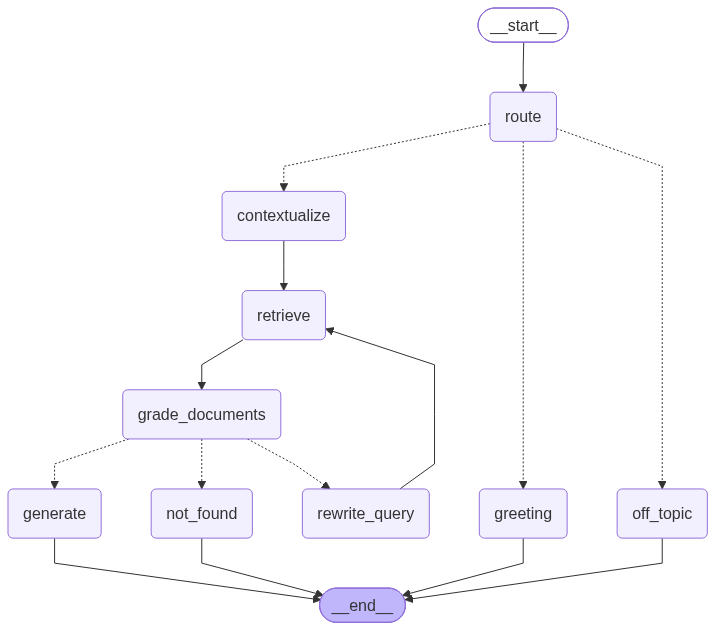

Stack: Gemini (LLM) · Google embeddings · FAISS · LangGraph · Streamlit
Requires PYTHON 3.12+

## Run
```bash
pip install -r requirements.txt
```

Set the API key (or paste it in the sidebar):

```bash
# bash / Git Bash
export GOOGLE_API_KEY="your-key"

# PowerShell
$env:GOOGLE_API_KEY="your-key"
```

```bash
streamlit run app.py
```

Upload a PDF/TXT/MD, click **Process document**, then chat. The FAISS index and a document summary are saved under `data/` and reloaded on the next run when the API key is present.

## Agent flow
```
route -> greeting | off_topic | contextualize -> retrieve -> grade_documents -> generate
                                              └─ no relevant docs -> rewrite_query -> retrieve (max 2 retries) -> not_found
```


Follow-up questions use recent chat history. Tune models, chunking, top-k, retries, and history length in `config.py`.
